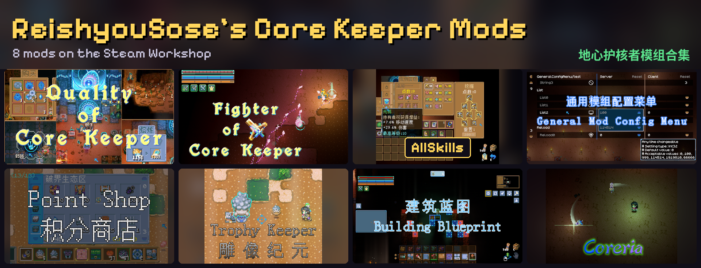

# ReishyouSose's Core Keeper mods

[中文说明](README.zh-CN.md)

Source code for ReishyouSose's Core Keeper mods, built with the official Core Keeper Mod SDK. Install them from the [Steam Workshop](https://steamcommunity.com/id/1657188940/myworkshopfiles/?appid=1621690).

## Mods

| Mod | What it does | Needs |
|---|---|---|
| [CoreEnhance](https://steamcommunity.com/sharedfiles/filedetails/?id=3721031561) | Many quality-of-life options, each with its own switch: endless durability and ore rocks, faster crafting, crops and merchant refreshes, automation helpers and pet options. It does not work on Linux dedicated servers yet. | CoreLib, GeneralConfigMenu |
| [CoreFighter](https://steamcommunity.com/sharedfiles/filedetails/?id=3721040464) | Combat options: endless mana, hunger and explosives, no recoil, immunity to explosions and knockback, teleporting to a map marker (hold Shift), life steal, and shorter cooldowns for tools, weapons, off-hand items and food. | CoreLib, GeneralConfigMenu |
| [AllSkills](https://steamcommunity.com/sharedfiles/filedetails/?id=3721047666) | Changes how talent points are counted: one every 3 skill levels up to level 60, then one every 2 levels. Pets get one talent point per level after level 1. | - |
| [GeneralConfigMenu](https://steamcommunity.com/sharedfiles/filedetails/?id=3721094795) | A menu in the game settings that changes mod settings while you play, with no restart. Works on dedicated servers too. Other mods here use it. | CoreLib |
| [PointShop](https://steamcommunity.com/sharedfiles/filedetails/?id=3721095168) | Defeat bosses to earn points and unlock shops that trade points for items. Bind its key first under Settings > Key Bindings > Mods. | CoreLib |
| [TrophyKeeper](https://steamcommunity.com/sharedfiles/filedetails/?id=3721099336) | An extra chance for enemies to drop their trophy (bosses not included). Enemies from a spawner platform can drop loot too. | CoreLib |
| [BuildingBlueprint](https://steamcommunity.com/sharedfiles/filedetails/?id=3753254765) | Select an area, save it as a blueprint and paste it somewhere else. Pasting uses items from your inventory. Bind its key under Controls > Mods. It needs elevated access. | CoreLib |
| [Coreria](https://steamcommunity.com/sharedfiles/filedetails/?id=3832200101) | Adds items from Terraria, starting with the Zenith. Its folder here is `TerraZenith`. | CoreLib |

[CoreLib](https://steamcommunity.com/sharedfiles/filedetails/?id=3673516180) is a separate library mod. Subscribe to it as well.

Each mod lives in its own folder under `Assets/`. The other folders there come from the Mod SDK or hold mods that are not on the Workshop.

## Building the mods

This repo is a copy of the Core Keeper Mod SDK with the mods added. The steps below come from the SDK's own README.

### Requirements

* Unity Hub, available for download on [Unity's website](https://unity.com/unity-hub)
* Unity Editor 6000.0.59f2. Unity Hub installs it for you if you follow the steps below.

### How to run

1. Download the project to your PC, either with Git or by clicking _Code > Download ZIP_ and extracting the archive anywhere. The main branch is `1.2`.
2. Install and open Unity Hub. Press "Add -> Add project from disk" and select the folder where you downloaded the project. It should now appear in the Unity Hub projects list.
3. (Optional) Press the three dot menu next to the project, select "Add command line arguments", add `-disable-assembly-updater` and press Save. This is not required, but it removes some errors from the log when you open the project.
4. Open the project. If you don't have a matching Unity Editor version yet, Unity Hub will guide you through installing it. Make sure to enable "Linux Build Support (Mono)", or you won't be able to install or build mods. All other options can stay at their default values.

For a more detailed guide, see [this page on mod.io](https://mod.io/g/corekeeper/r/core-keeper-mod-sdk-introduction).

## Bugs, ideas and pull requests

Bug reports, ideas and pull requests are welcome. See [CONTRIBUTING.md](CONTRIBUTING.md). For a crash or a gameplay bug, please attach your `Player.log`.

For questions about modding in general, try the mod-help channel on the [Core Keeper Discord server](https://discord.gg/CoreKeeper).
