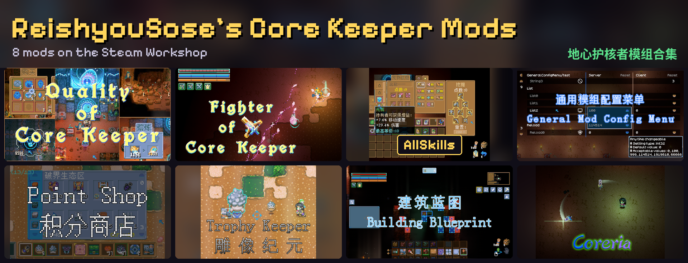

# ReishyouSose 的 Core Keeper 模组

[English](README.md)

ReishyouSose 的 Core Keeper（地心护核者）模组源代码，使用官方 Core Keeper Mod SDK 制作。可以在 [Steam 创意工坊](https://steamcommunity.com/id/1657188940/myworkshopfiles/?appid=1621690) 订阅。

## 模组列表

| 模组 | 功能 | 前置 |
|---|---|---|
| [CoreEnhance](https://steamcommunity.com/sharedfiles/filedetails/?id=3721031561) | 大量便利功能，每项都可以单独开关：无限耐久和矿岩、加速制造、作物生长和商店刷新、自动化辅助以及宠物相关功能。目前无法在 Linux 专用服务器上使用。 | CoreLib、GeneralConfigMenu |
| [CoreFighter](https://steamcommunity.com/sharedfiles/filedetails/?id=3721040464) | 战斗相关：无限魔力、饥饿和爆炸物，无后坐力，免疫爆炸和击退，地图标记传送（按住 Shift），吸血，以及修改工具、武器、副手和消耗品的冷却时间。 | CoreLib、GeneralConfigMenu |
| [AllSkills](https://steamcommunity.com/sharedfiles/filedetails/?id=3721047666) | 修改天赋点的计算方式：60 级以内每 3 级 1 点，60 级以上每 2 级 1 点。宠物 1 级以后每升 1 级得 1 点天赋。 | 无 |
| [GeneralConfigMenu](https://steamcommunity.com/sharedfiles/filedetails/?id=3721094795) | 游戏设置里的通用模组配置菜单，游戏中实时修改模组配置，无需重启。支持专用服务器。这里的其他模组也用它。 | CoreLib |
| [PointShop](https://steamcommunity.com/sharedfiles/filedetails/?id=3721095168) | 击败 Boss 获得点数，解锁对应商店，用点数兑换物品。首次使用请先在 设置 - 按键绑定 - 模组 里绑定按键。 | CoreLib |
| [TrophyKeeper](https://steamcommunity.com/sharedfiles/filedetails/?id=3721099336) | 敌人额外的奖杯掉落几率（不包括 Boss）。刷怪平台生成的敌人也可以掉落战利品。 | CoreLib |
| [BuildingBlueprint](https://steamcommunity.com/sharedfiles/filedetails/?id=3753254765) | 选择一块区域，保存为蓝图，再粘贴到别处。粘贴时会消耗背包里的物品。请在 控制 - 模组 里绑定按键。需要提升权限（elevated access）。 | CoreLib |
| [Coreria](https://steamcommunity.com/sharedfiles/filedetails/?id=3832200101) | 加入泰拉瑞亚的物品，目前有天顶剑（Zenith）。它在这里的文件夹叫 `TerraZenith`。 | CoreLib |

[CoreLib](https://steamcommunity.com/sharedfiles/filedetails/?id=3673516180) 是单独的前置库模组，请一并订阅。

每个模组在 `Assets/` 下有自己的文件夹。其他文件夹来自 Mod SDK，或者是还没有发布到创意工坊的模组。

## 构建模组

这个仓库是加入了模组的 Core Keeper Mod SDK。下面的步骤来自 SDK 自带的 README。

### 需要

* Unity Hub，可以从 [Unity 官网](https://unity.com/unity-hub) 下载
* Unity Editor 6000.0.59f2。按下面的步骤操作，Unity Hub 会自动安装。

### 运行步骤

1. 把项目下载到电脑上：用 Git，或者点 _Code > Download ZIP_ 并解压到任意位置。主分支是 `1.2`。
2. 安装并打开 Unity Hub。点 "Add -> Add project from disk"，选择项目所在的文件夹。项目会出现在 Unity Hub 的项目列表里。
3. （可选）点项目旁边的三个点菜单，选择 "Add command line arguments"，加上 `-disable-assembly-updater` 并保存。这一步不是必须的，但可以减少打开项目时日志里的错误。
4. 打开项目。如果还没有对应版本的 Unity Editor，Unity Hub 会引导你安装。一定要勾选 "Linux Build Support (Mono)"，否则无法安装或构建模组。其他选项保持默认即可。

更详细的入门说明请看 [mod.io 上的这篇指南](https://mod.io/g/corekeeper/r/core-keeper-mod-sdk-introduction)（英文）。

## 问题、建议和 PR

欢迎提交问题、建议和 Pull Request，请看 [CONTRIBUTING.md](CONTRIBUTING.md)。如果是崩溃或游戏内的 bug，请附上 `Player.log`。

一般的模组制作问题，可以去 [Core Keeper Discord 服务器](https://discord.gg/CoreKeeper) 的 mod-help 频道提问。
